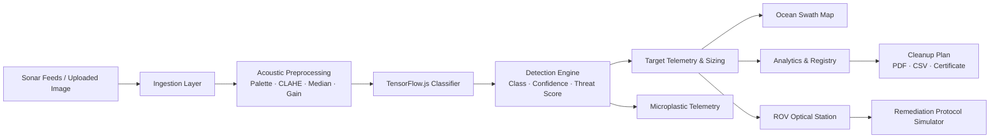
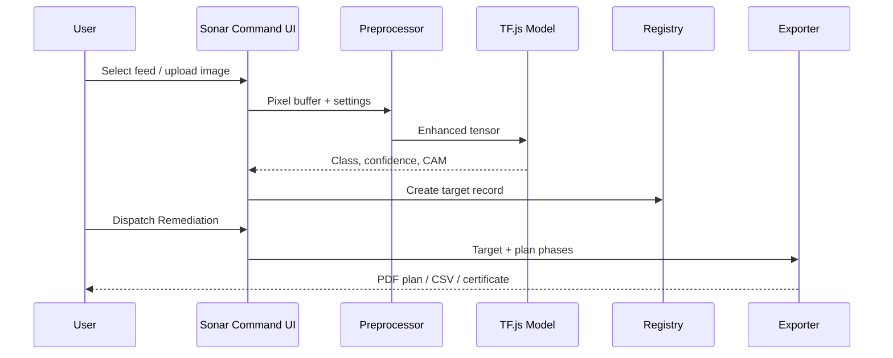
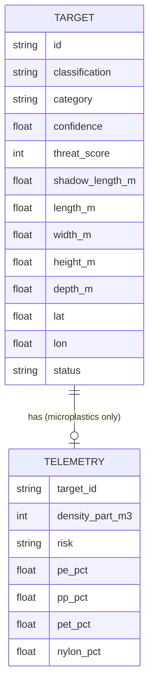

# AquaGuard — Technical Design Document

## 1. Purpose
Detect and prioritise seabed debris and microplastic hotspots from sonar imagery, and turn detections into actionable remediation plans, entirely in the browser.

## 2. Goals / Non-goals
**Goals:** zero-backend deployment, fast in-browser inference, explainable output (CAM heatmap), printable/exportable plans.
**Non-goals:** real-time hardware control, field-calibrated density estimation, operational munitions clearance.

## 3. System architecture

## 4. Module breakdown

| Module | Responsibility | Inputs | Outputs |
|---|---|---|---|
| Ingestion | Load preset feeds or user image (PNG/JPG/TIFF) onto canvas | File / preset | Raw pixel buffer |
| Preprocessing | Palette mapping, CLAHE, 3×3 median speckle filter, gain | Pixel buffer, UI params | Enhanced image |
| Classifier | TF.js inference, CAM heatmap | Enhanced image tensor | Class probabilities, heatmap |
| Detection / Scoring | Maps class + confidence + shadow geometry to threat score (0–100) | Classifier output | Target records |
| Sizing | Estimates dimensions from acoustic shadow length and slant angle | Shadow length | L × W × H estimate |
| Microplastic telemetry | Density, risk tier, polymer split | Plume detection | Telemetry card |
| Registry & Analytics | Roster, filters, taxonomy and depth-vs-threat charts | Target records | Tables / charts |
| ROV Station | Simulated optical inspection, lighting, manipulator tools | Selected target | Visual/log output |
| Mission Planner | Remediation phases, certificate, export | Selected target | Plan, PDF, CSV |

## 5. Data flow (single scan)

## 6. Data model

Threat tiers: **Critical** ≥ 80 · **Moderate** 40–79 · **Low** < 40 (sample-data convention).

## 7. Technology stack
- **Frontend:** HTML5, CSS3, JavaScript (single-page, tabbed views)
- **ML:** TensorFlow.js (in-browser inference, CAM explainability)
- **Imaging:** Canvas API (CLAHE, median filter, false-colour LUTs)
- **Export:** browser print-to-PDF, CSV download
- **Hosting:** Netlify static hosting

## 8. Design decisions
1. **Client-side only** — no server cost, no data leaves the device, works offline after load.
2. **CAM heatmap** — shows which acoustic region drove the classification.
3. **Synthesised ROV optics** — avoids needing real footage; clearly labelled as synthesised.
4. **CSV + PDF export** — plugs into GIS and reporting workflows.

## 9. Security & privacy
- Uploaded images are processed locally and never transmitted.
- No credentials, tokens or backend endpoints.
- Third-party scripts limited to the ML runtime.

## 10. Testing strategy
- Automated: sample-data schema and aggregate checks (`tests/validate-sample-data.js`).
- Manual: UI scenarios in `tests/TEST_CASES.md`.

## 11. Limitations & future work
- Replace synthetic sample data with field-validated survey data.
- Calibrate density estimation against ELIXIR catamaran sampling.
- Add GeoJSON export and live sensor ingestion.
- Quantise/optimise the model for low-end devices.
